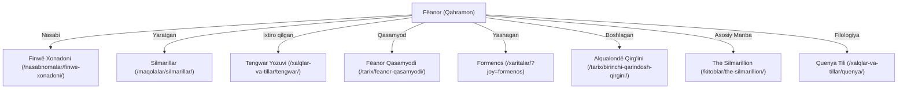

# 02. INFORMATION ARCHITECTURE AND URL CONVENTIONS

**Loyiha nomi:** TOLKIEN OLAMI  
**Hujjat holati:** Faza 7 (Jarayonda — Yangilandi)  
**Oxirgi yangilanish:** 2026-10-29

---

## 1. Sayt Xaritasi (Sitemap) va 11 Asosiy Boʻlim

Ensiklopediya 11 ta asosiy boʻlimga boʻlinadi. Har bir boʻlim aniq URL tuzilmasi, navigatsiya va meta-maʼlumotlarga ega.

```
/ (Bosh sahifa)
├── xaritalar/                    (2. Interaktiv Atlas)
├── qahramonlar/                  (3. Qahramonlar va Shaxslar)
│   └── [slug]/
├── nasabnomalar/                 (4. Nasabnomalar va Shajaralar)
│   └── [slug]/
├── tarix/                        (5. Tarix, Davrlar va Xronologiya)
│   └── [slug]/
├── kitoblar/                     (6. Asarlar va Bibliografiya)
│   └── [slug]/
├── olam/                         (7. Arda va Kosmologiya)
│   └── [slug]/
├── xalqlar-va-tillar/            (8. Xalqlar, Tillar va Yozuvlar)
│   └── [slug]/
├── tolkien/                      (9. J.R.R. Tolkien Hayoti va Merosi)
│   └── [slug]/
├── maqolalar/                    (10. Tahliliy Maqolalar, Mavzular va Manbalar)
│   └── [slug]/
└── qidiruv/                      (11. Global Qidiruv Tizimi)
```

---

## 2. Boʻlimlarning Batafsil Spetsifikatsiyasi

### 1. Bosh Sahifa (`/`)
- **Vazifasi:** Ensiklopediyaga kirish eshigi. Editorial darajadagi manifest, asosiy 11 yoʻnalishga koʻrsatkichlar, kunlik kanonik iqtibos, yangi tadqiqotlar va interaktiv xaritaga kirish nuqtasi.
- **Tuzilishi:** Minimalist sarlavha, afsonalar xronologiyasi panjarasi, tanlangan ilmiy maqola, qidiruv maydoni.

### 2. Interaktiv Atlas — Xaritalar (`/xaritalar/`)
- **Vazifasi:** Arda, Beleriand, Númenor va Oʻrta-yer xaritalari orqali geografik navigatsiya.
- **URL parametrlari va Holat (State):** 
  - `?hudud=beleriand` (Xarita qatlami: `beleriand` va `orta-yer` mavjud; `numenor` va `valinor` Faza 7 ga rejalashtirilgan, qarang: `docs/10_CURRENT_STATE.md`)
  - `?davr=birinchi-davr` (Xronologik qatlam)
  - `?joy=gondolin` (Tanlangan lokatsiya slugi)
  - `?x=...&y=...&z=...` (Plonar xarita koordinatalari va masshtabi)
- **Koordinatalar Falsafasi:** Tolkienning afsonaviy xaritalari sharsimon Yer shari geografiyasi emas, balki planar (tekis) afsonaviy kartografiyadir. Shu sababli haqiqiy Yer koordinatalari (`lat` va `lng`) oʻrniga qatʼiy tekislik piksellari (`{ x, y }` va URL-da `?x=...&y=...&z=...`) ishlatiladi. Agar parametrlar kiritilmasa yoki notoʻgʻri/chegaradan tashqari boʻlsa, xarita avtomatik tarzda xavfsiz markaziy koordinataga (default view) qaytadi.
- **Bogʻlanishlar:** Har bir lokatsiya tegilganda oʻng tomondagi qatʼiy ajratilgan paneldan unga oid shaxslar, urushlar va kitob havolalari chiqadi.

### 3. Qahramonlar va Shaxslar (`/qahramonlar/`)
- **URL andozasi:** `/qahramonlar/[slug]/` (masalan: `/qahramonlar/feanor/`, `/qahramonlar/galadriel/`, `/qahramonlar/aragorn/`).
- **Katalog filtrlari:** Irq/Tur (Elflar, Insonlar, Mitti odamlar, Ainur...), Madaniyat/Xalq (Noldor, Vanyar, Dúnedain...), Yashagan davri (Birinchi, Ikkinchi, Uchinchi davr).
- **Ichki tuzilishi:** Qisqa ilmiy konspekt, etimologiya va muqobil nomlar, hayot xronologiyasi, yaratgan buyumlari, oilaviy aloqalari, kanonik manbalar va iqtiboslar.

### 4. Nasabnomalar — Shajaralar (`/nasabnomalar/`)
- **URL andozasi:** `/nasabnomalar/[slug]/` (masalan: `/nasabnomalar/finwe-xonadoni/`, `/nasabnomalar/elros-avlodlari/`).
- **Vazifasi:** Shajaralarning grafik va ierarxik tasviri. Har bir tugun bosilganda mos qahramon sahifasiga oʻtadi yoki qisqacha maʼlumot kartasini ochadi.

### 5. Tarix va Xronologiya (`/tarix/`)
- **URL andozasi:** `/tarix/[slug]/` (masalan: `/tarix/ainulindale/`, `/tarix/daraxtlar-davri/`, `/tarix/birinchi-davr/`).
- **Tuzilishi:** Buyuk davrlar (Aynur musiqasi, Valinor yillari, Quyoshning 1-, 2-, 3- va 4-davrlari) va asosiy tarixiy voqealar (Nirnaeth Arnoediad, Dagor Bragollach, Halqa urushi).

### 6. Kitoblar va Bibliografiya (`/kitoblar/`)
- **URL andozasi:** `/kitoblar/[slug]/` (masalan: `/kitoblar/the-silmarillion/`, `/kitoblar/the-lord-of-the-rings/`, `/kitoblar/history-of-middle-earth-vol-1/`).
- **Tuzilishi:** Asarning asl nashr tarixi, qoʻlyozma evolyutsiyasi, boblar mundarijasi, Christopher Tolkien tahriri xususiyatlari, oʻzbekcha tarjima holati (agar mavjud boʻlsa) va tadqiqot havolalari.

### 7. Arda va Kosmologiya (`/olam/`)
- **URL andozasi:** `/olam/[slug]/` (masalan: `/olam/arda/`, `/olam/ikki-daraxt/`, `/olam/quyosh-va-oy/`).
- **Tuzilishi:** Koinot (Eä), Cheksiz Boʻshliq (Kúma), Yashirin Olov (Secret Fire), Yassi Arda (Flat Earth) va Dumaloq Arda (Round Earth) kosmologik evolyutsiyasi.

### 8. Xalqlar, Tillar va Yozuv Tizimlari (`/xalqlar-va-tillar/`)
- **URL andozasi:** `/xalqlar-va-tillar/[slug]/` (masalan: `/xalqlar-va-tillar/quenya/`, `/xalqlar-va-tillar/sindarin/`, `/xalqlar-va-tillar/tengwar/`, `/xalqlar-va-tillar/noldor/`).
- **Tuzilishi:** Tolkien filologiyasi va etnografiyasi: tillar oilasi, yozuv qoidalari (Tengwar, Cirth), hamda xalqlar va irqlar madaniyati (Noldor, Edain, Xazad).

### 9. Tolkienning Hayoti va Merosi (`/tolkien/`)
- **URL andozasi:** `/tolkien/[slug]/` (masalan: `/tolkien/tarjimai-hol/`, `/tolkien/oksford-yillari/`, `/tolkien/xatlar/`).
- **Tuzilishi:** Professor Tolkienning biografiyasi, Birinchi jahon urushi taʼsiri, Inklings toʻgaragi, Oksforddagi ilmiy faoliyati, xatlar tahlili (*Letters of J.R.R. Tolkien*).

### 10. Maqolalar, Mavzular va Manbalar (`/maqolalar/`)
- **URL andozasi:** `/maqolalar/[slug]/` (masalan: `/maqolalar/olim-va-boqiylik-mavzusi/`, `/maqolalar/feanor-qasamyodi-tahlili/`).
- **Tuzilishi:** Teologik va falsafiy mavzular (taqdir, erkin iroda, oʻlim, tabiat va mashinasozlik), ilmiy maqolalar, manbalar tanqidi.

### 11. Global Qidiruv (`/qidiruv/`)
- **URL:** `/qidiruv/` (va global dialog orqali `Cmd+K` / `Ctrl+K`).
- **Vazifasi:** Toʻliq matnli, tezkor, diakritikaga sezgir statik qidiruv tizimi.

---

## 3. Oʻzaro Bogʻlangan Bilimlar Grafigi (Knowledge Graph Model)

Ensiklopediyada har bir entiti boshqa barcha bogʻliq entitilar bilan ikki tomonlama bogʻlanadi.

### Misol: Fëanor (`/qahramonlar/feanor/`) Sahifasining Bogʻlanish Grafigi:



Har bir sahifaning pastki qismida yoki chetki hoshiyasida (Scholarly Margin) ushbu bogʻlanishlar aniq metadata bloklarida koʻrsatiladi.

---

## 4. URL Qoidalari, Slug Normalizatsiyasi va Toʻqnashuvlar Boshqaruvi

### 4.1. Kanonik URL va Slug Normalizatsiyasi Standarti
Barcha kanonik URL sluglari deterministik va qatʼiy qoidalarga boʻysunadi:
1. **Faqat kichik ASCII harflar va defislar:** Sluglar faqat `[a-z0-9-]` belgilaridan iborat boʻladi.
2. **Oʻzbek lotin harflari normalizatsiyasi:** 
   - `oʻ`, `o‘`, `o'`, `o’` harflari qatʼiy ravishda `o` harfiga oʻgiriladi.
   - `gʻ`, `g‘`, `g'`, `g’` harflari qatʼiy ravishda `g` harfiga oʻgiriladi.
   - Barcha turdagi apostroflar, tutuq belgilari (`ʼ`, `'`, `’`, U+02BB, U+02BC) olib tashlanadi yoki soʻz chegarasida defisga aylantiriladi.
3. **Tolkien diakritikalarini tekislash:** 
   - `ë`, `é`, `ê`, `ē` → `e`
   - `ä`, `á`, `â`, `ā` → `a`
   - `í`, `î`, `ī` → `i`
   - `ó`, `ô`, `ō`, `ö` → `o`
   - `ú`, `û`, `ū`, `ü` → `u`
   - `ñ` → `n`
4. **Defislar tozaligi:** Bir nechta ketma-ket defislar bittaga keltiriladi (`--` → `-`), boshidagi va oxiridagi defislar qirqiladi.

### 4.2. Asl Imlo Butunligi (Display Fidelity Rule)
> [!IMPORTANT]
> **Slug normalizatsiyasi hech qachon sahifa sarlavhasini yoki kontent imlosini oʻzgartirmaydi.**  
> URL manzili `/tarix/birinchi-qarindosh-qirgini/` boʻlgani holda, sahifaning H1 sarlavhasi, navigatsiya roʻyxati va maqola matnida toʻliq akademik imlo saqlanadi: **«Birinchi Qarindosh Qirgʻini (Alqualondë)»**. Xuddi shuningdek, `/qahramonlar/feanor/` manzili ostidagi qahramonning ekrandagi nomi qatʼiy ravishda **Fëanor** boʻlib qoladi.

### 4.3. Slug Toʻqnashuvlarini Aniqlash va Bartaraf Etish (Collision Resolution)
1. **Sukut saqlab ustiga yozish taqiqlanadi:** Ikkita alohida entiti (masalan, turli davrlarda yashagan bir xil ismli qahramonlar) bitta slug hosil qilganda tizim hech qachon ularni jimgina birlashtirib yubormaydi yoki birini yoʻqotmaydi.
2. **Kompilyatsiya vaqtida toʻxtatish (Build-Time Failure):** Sayt yigʻilishida va Vitest testlarida barcha toʻplamlar boʻyicha sluglar lugʻati tekshiriladi. Agar toʻqnashuv yuz bersa, build darhol toʻxtatiladi:
   `Error: Slug collision detected! Both "Morwen (Eledhwen)" and "Morwen (of Lossarnach)" resolve to slug "morwen".`
3. **Semantik aniqlashtirish qoidasi:** Avtomatik sonlar qoʻshish (`morwen-1`, `morwen-2`) qatʼiyan taqiqlanadi. Muallif/tahririyat Zod sxemasida yoki fayl nomida qahramonning kanonik epitetini yoki xonadonini qoʻshib aniqlashtirishi shart:
   - `/qahramonlar/morwen-eledhwen/`
   - `/qahramonlar/morwen-lossarnach/`

### 4.4. Deterministik Normalizatsiya Algoritmi
```typescript
export function toCanonicalSlug(input: string): string {
  return input
    .toLowerCase()
    .trim()
    // 1. Oʻzbek maxsus harflarini xavfsiz almashtirish
    .replace(/o['ʻ‘ʼ’`]/gu, 'o')
    .replace(/g['ʻ‘ʼ’`]/gu, 'g')
    // 2. Tutuq belgilari va barcha turdagi apostroflarni o'chirish
    .replace(/['ʻ‘ʼ’`]/gu, '')
    // 3. NFD orqali diakritik belgilarni ajratib, asosiy harfni qoldirish
    .normalize('NFD')
    .replace(/\p{Diacritic}/gu, '')
    // 4. Lotin harfi va raqam bo'lmagan belgilarni defisga aylantirish
    .replace(/[^a-z0-9]+/g, '-')
    // 5. Ortiqcha defislarni tozalash
    .replace(/^-+|-+$/g, '');
}
```

### 4.5. Kanonik Manzillar va Holat (Canonical & State URLs)
1. Har bir sahifa `<link rel="canonical" href="https://tolkienolami.uz/boʻlim/slug/" />` tegiga ega boʻladi.
2. Xarita yoki katalogdagi filtrlash holati doim query parametrlari bilan yuritiladi: `/xaritalar/?hudud=beleriand&x=1200&y=850&z=3`. Fictional xarita koordinatalari hech qachon global sessiyaga bogʻlanmaydi, URL orqali toʻliq ulashilishi (shareable) mumkin.
